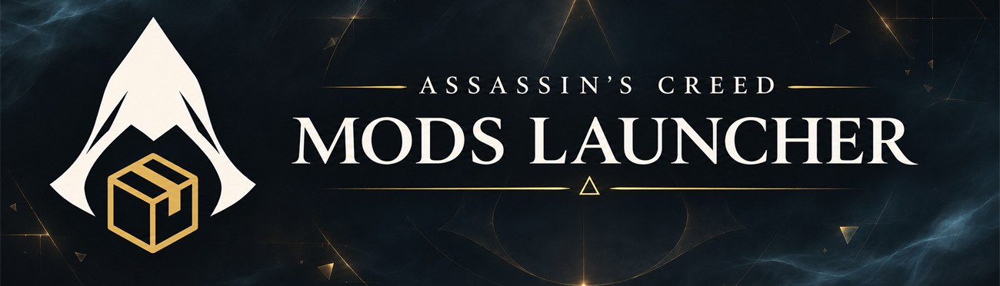
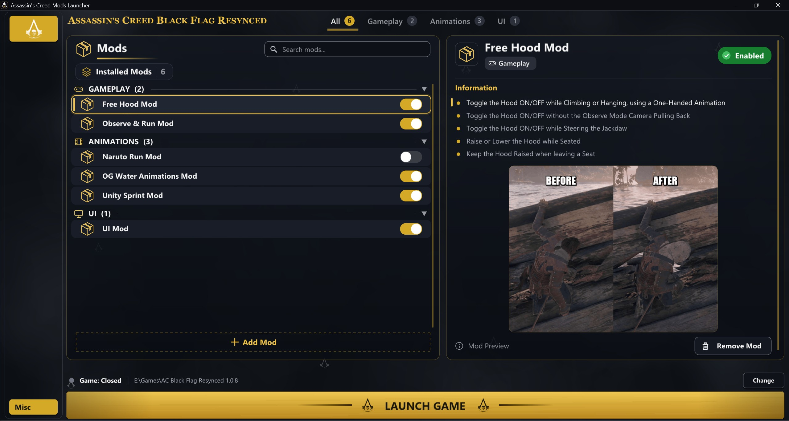
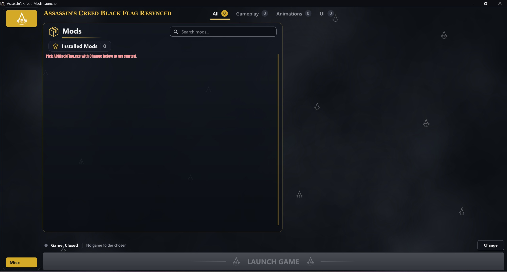
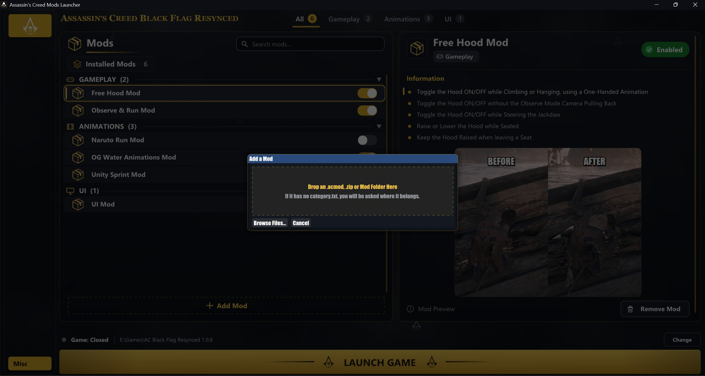
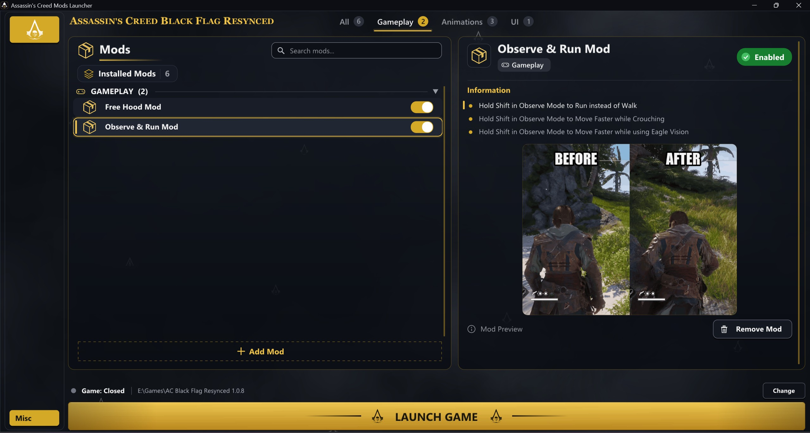
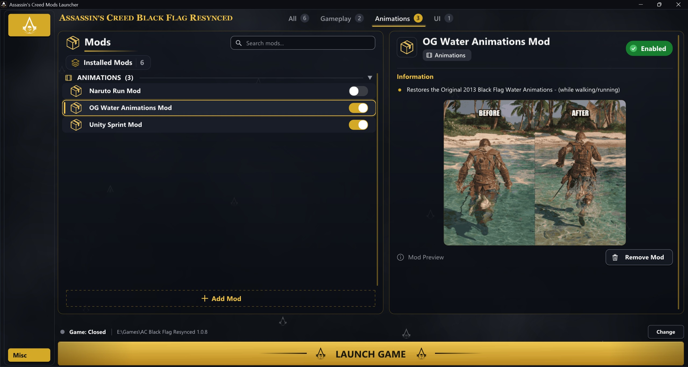
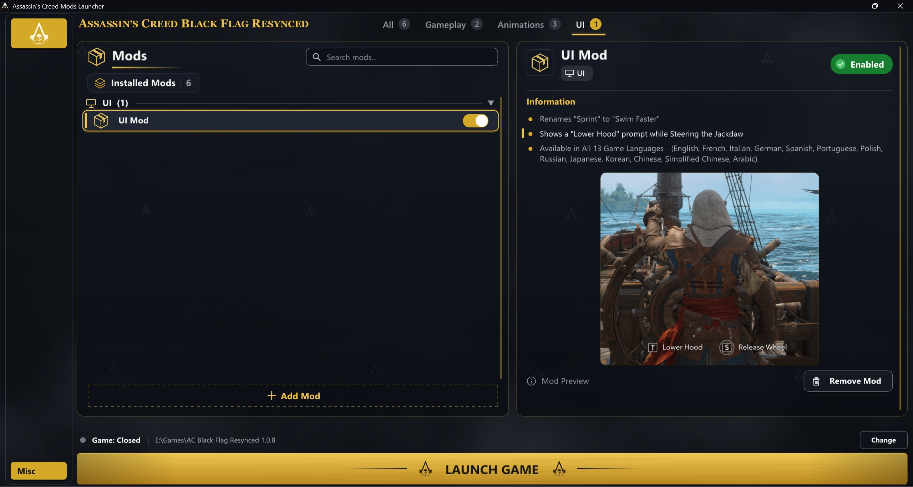
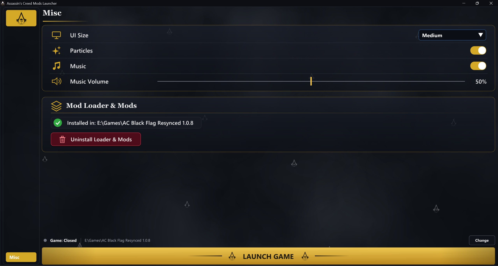
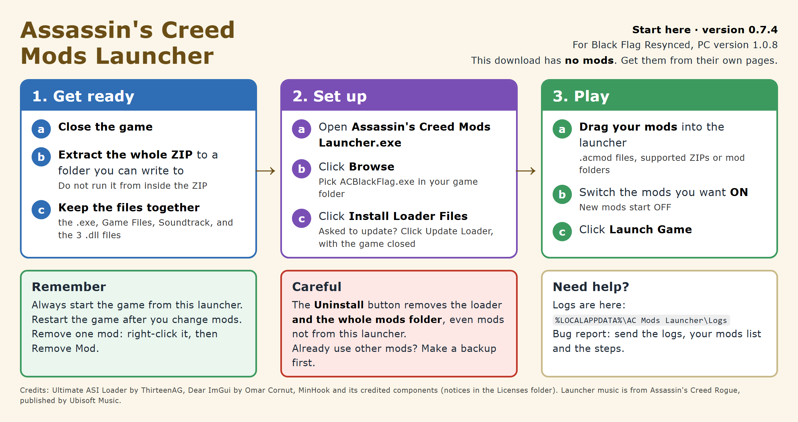

  

<h1 align="center">Assassin's Creed Mods Launcher</h1>

  Your Assassin's Creed mods, in one place. 
  Import, preview and manage mods, then launch your game.

  <a href="../../releases/latest"><b>Download The Latest Version</b></a>
  &nbsp;|&nbsp;
  <a href="https://www.nexusmods.com/assassinscreedblackflagresynced/mods/658">Nexus Mods Page</a>
  &nbsp;|&nbsp;
  <a href="https://www.nexusmods.com/assassinscreedblackflagresynced/mods/659">Mods</a>
  &nbsp;|&nbsp;
  <a href="https://www.virustotal.com/gui/file/979e8d9044b418aaf211553b957de93b060650920be7fe3821e60f92fdf391ab?nocache=1">VirusTotal</a>

---

## What it is

A portable launcher for compatible Assassin's Creed mods. Add the mods you want, switch them on or off, and start the game with your chosen setup. There is no installer: extract the folder and open the launcher.

**Currently supports:** Assassin's Creed Black Flag Resynced, PC version 1.0.8.
More Assassin's Creed games are planned. The launcher only supports the game and version listed here.

**Mods are not included.** This download is the launcher and its loader files only. Mods are released separately on their own pages, for example the Overhauled collection.

## Features

- Import compatible `.acmod` packages, ZIP files and mod folders.
- Switch individual mods on or off before you play.
- Read each mod's description and see before and after previews.
- Browse by category and search by name.
- Mods that replace the same game objects are switched off automatically, so they do not clash.
- Install or update the game's loader files from inside the launcher.
- Your original `.forge` game archives are never replaced.
- Adjust the interface size, background particles, music and volume.

## Screenshots

   
  Your mods by category, with a description and a before and after preview.

  
   
  First start: pick the game. Add a mod by dropping a file or folder in.

  
   
  Previews supplied by the mod authors.

  
   
  Settings: interface size, particles, music and volume, and the loader status.

## Quick start

  

1. Close the game. Extract the whole ZIP to a folder you can write to. Do not run the launcher from inside the ZIP.
2. Open **Assassin's Creed Mods Launcher.exe**. Keep the Game Files and Soundtrack folders and the three `.dll` files beside it.
3. Click **Browse** and pick `ACBlackFlag.exe` in your game folder.
4. Click **Install Loader Files** if you see it. If it offers **Update Loader**, accept it with the game closed.
5. Download mods separately. Drag their `.acmod` files, ZIPs or folders into the launcher, or use its mod **Browse** button.
6. New mods start **off**. Switch on the ones you want and click **Launch Game**.

Always start the game from the launcher. Restart the game after you change which mods are on.

## Good to know

- Only mods made for the supported game and this launcher will work. Importing a ZIP does not make every Nexus mod compatible.
- Already use another ASI loader, or older manual `.forge` versions of the same mods? Check that first and make a backup. Do not overwrite an existing loader.
- Right-click a mod and choose **Remove Mod** to remove it.
- The **Uninstall Loader & Mods** button removes the loader files **and the whole mods folder**, including mods that did not come from this launcher. Read the confirmation window. Removed files go to the Recycle Bin.

## Troubleshooting

If a mod does not show up in the game, check the selected game, make sure the mod is switched on, accept any loader update, then use **Launch Game**.

Logs are saved in `%LOCALAPPDATA%\AC Mods Launcher\Logs`. When you report a problem, please include your game and launcher versions, the mods you have switched on, any other mods installed, and the steps that cause it. Check the logs for personal folder names before sharing them.

## Antivirus warnings

The launcher is an unsigned program, and some antivirus tools are cautious about those. The 0.7.5 download scanned clean on VirusTotal (0 detections from 67 security vendors). You can check any file yourself by uploading it to [VirusTotal](https://www.virustotal.com/).

## Credits

- [Ultimate ASI Loader](https://github.com/ThirteenAG/Ultimate-ASI-Loader) by ThirteenAG
- [Dear ImGui](https://github.com/ocornut/imgui) by Omar Cornut
- [MinHook](https://github.com/TsudaKageyu/minhook) and its credited components

Their licence notices are included in the download's `Licenses` folder. The launcher's background music is from Assassin's Creed Rogue, published by Ubisoft Music.

## Licence

Free for personal, non-commercial use. See [LICENSE](LICENSE) for the full terms, including what you may and may not do with the download.

This is an unofficial fan-made tool. It is not affiliated with or endorsed by Ubisoft. Assassin's Creed and related marks belong to their owners.
